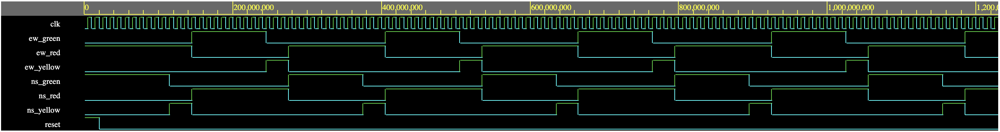

# VHDL Traffic Light Controller

A two-way intersection traffic light controller written in VHDL, with a self-checking testbench. Designed and simulated with GHDL in [EDA Playground](https://edaplayground.com).



## Overview

The controller is a Moore finite state machine that cycles through four states. A counter holds each state for a configurable number of clock cycles.

| State | North-South | East-West |
|-------|-------------|-----------|
| `NS_GREEN_S`  | Green  | Red    |
| `NS_YELLOW_S` | Yellow | Red    |
| `EW_GREEN_S`  | Red    | Green  |
| `EW_YELLOW_S` | Red    | Yellow |

The sequence repeats forever: NS green, NS yellow, EW green, EW yellow.

### Parameters

| Generic | Default | Meaning |
|---------|---------|---------|
| `GREEN_TIME`  | 10 | Clock cycles each direction stays green |
| `YELLOW_TIME` | 3  | Clock cycles each direction stays yellow |

### Ports

| Port | Direction | Description |
|------|-----------|-------------|
| `clk` | in | Clock |
| `reset` | in | Synchronous, active high. Returns the controller to `NS_GREEN_S` |
| `ns_red`, `ns_yellow`, `ns_green` | out | North-South lights |
| `ew_red`, `ew_yellow`, `ew_green` | out | East-West lights |

## Files

- `design.vhd`: the traffic light controller (entity `traffic`)
- `testbench.vhd`: the self-checking testbench (entity `tb_traffic`)
- `waveform.png`: waveform from a simulation run

## Testbench

The testbench resets the design, runs it for 120 clock cycles, and checks on every falling clock edge that:

1. Both directions are never green at the same time.
2. Each direction has exactly one light on.

At the end it checks that both directions received a green light. A failed check stops the simulation with a `FAIL` message. A passing run prints `PASS: all checks passed`.

## Running it

### In the browser (EDA Playground)

1. Go to [edaplayground.com](https://edaplayground.com).
2. Set the language to VHDL and the simulator to GHDL.
3. Paste `testbench.vhd` into the left pane and `design.vhd` into the right pane.
4. Set the top entity to `tb_traffic`, tick "Open EPWave after run", and click Run.
5. In EPWave, click Get Signals, select `tb_traffic`, and add `clk`, `reset`, and the six light signals.

### Locally (GHDL)

```
ghdl -a --std=08 design.vhd testbench.vhd
ghdl -e --std=08 tb_traffic
ghdl -r --std=08 tb_traffic --vcd=wave.vcd
gtkwave wave.vcd
```

## Possible extensions

- Add an all-red clearance state between yellow and the next green.
- Add a pedestrian button input and a walk phase.
- Run it on an FPGA board with LEDs for the lights.
